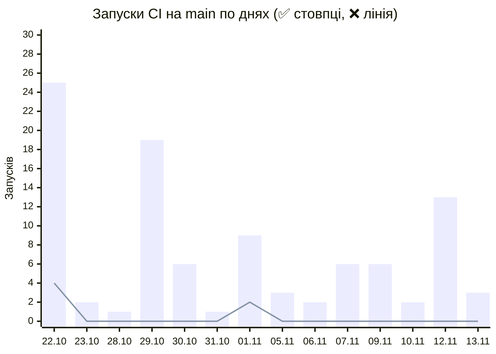
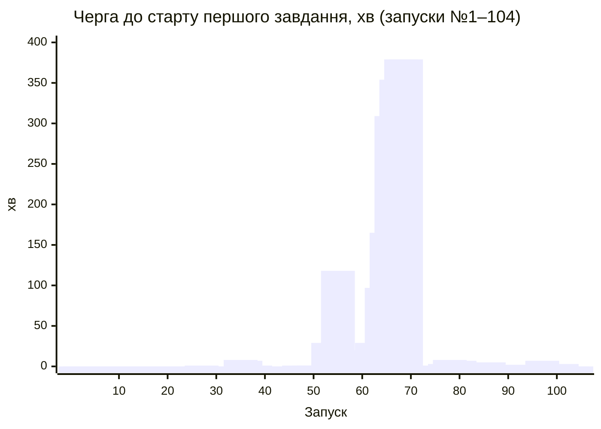
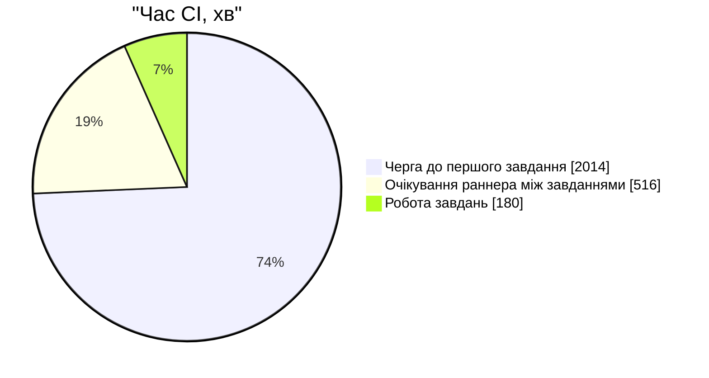
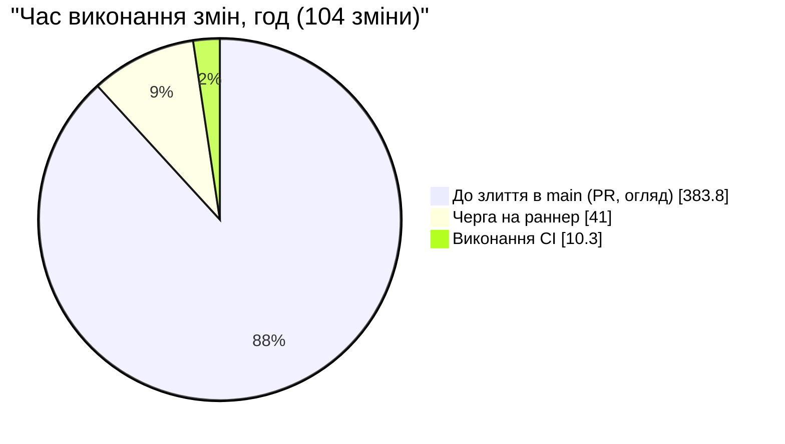

# Підсумок DORA і план покращень (Клініка продуктивності CI/CD)

**Дані:** [`metrics-raw.md`](metrics-raw.md) — 104 запуски workflow `CI` на `main`, 22.10–13.11.2026 (3,15 тижня). **Докази:** [`evidence/`](evidence/) — експорт запусків, час завдань і уривки логів червоних запусків.
**Що вважаємо розгортанням:** зелений запуск CI на `main`. За визначенням DORA розгортання — це вихід зміни в робоче середовище. У нас із `main` автоматично розгортаються GitHub Pages (документація API) і Render (API), але історію саме розгортань ми не збираємо. Тому всі числа нижче — **наближення** метрик DORA за історією CI.

---

## Які workflow враховано

На кожен коміт у `main` запускаються три workflow:

| Workflow | Файл | Коли запускається на `main` | Що робить | Запусків на `main` за 22.10–13.11 | Червоних |
|---|---|---|---|---:|---:|
| **CI** | `ci.yml` | кожен push | тести з покриттям на PostgreSQL, lint, перевірка OpenAPI (`api`), UML, тести продуктивності | 104 | 6 |
| Security | `security.yml` | кожен push + щопонеділка за розкладом | `pip-audit` (аудит залежностей) | 106 | 0 |
| Deploy API docs | `deploy-api-docs.yml` | push, лише якщо змінено `src/api/**`, `docs/api/**` або `requirements.txt` | публікація Swagger UI на GitHub Pages | 28 | 0 |

**Враховано лише `CI`.** Лише він перевіряє саму зміну: тести, стиль, контракт API. Решта workflow до дефектів у нашому коді не чутливі:
- **Security** перевіряє не наш код, а вразливості в залежностях. Колір його запуску залежить від того, чи опублікували новий CVE, а не від зміни. До того ж за весь період він ні разу не був червоним.
- **Deploy API docs** запускається лише для змін API (28 зі 104 комітів), тож не покриває кожну зміну. За період він теж ні разу не був червоним.

**Перевірка.** Лаба вимагає вважати коміт зеленим, лише коли зелені всі враховані workflow. Якби ми додали `Security` і `Deploy API docs`, результат не змінився б: усі їхні запуски за період зелені. Отже, червоних комітів так само 6, а частота збоїв змін так само 5,8 %.

> `Deploy API docs` — єдине **справжнє розгортання** в нашому конвеєрі: 28 публікацій документації API на GitHub Pages за 3,15 тижня, тобто ≈ 8,9 на тиждень. Метрики в §1 рахуємо за зеленими запусками CI, бо так визначено в лабі і бо Pages розгортається не з кожного коміту.

---

## 1. Чотири ключові метрики DORA

| Метрика | Формула | Наш результат | Категорія (DORA 2025: частка опитаних із таким або кращим результатом) |
|---|---|---|---|
| **Частота розгортань** | зелені запуски на `main` / тижні = 98 / 3,15 | **31,1 на тиждень** (≈ 4,5 на день); злиття йдуть хвилями в дні лаб: 69 % запусків — у 4 дні, у 9 з 23 днів злиттів не було | на вимогу (кілька разів на день) → **16,2 %** |
| **Час виконання змін** | від першого коміту PR до завершення зеленого запуску на `main` із цим комітом (104 зміни) | **середнє 4 год 11 хв, медіана 33 хв** | за медіаною менше години → **9,4 %**; за середнім менше доби → **24,4 %** |
| **Частота збоїв змін** | червоні запуски / усі завершені × 100 % = 6 / 104 | **5,8 %** | 4–8 % → **36,2 %** |
| **Час відновлення після невдалого розгортання** | від червоного запуску на `main` до наступного зеленого (6 червоних запусків) | **середнє 61 хв, медіана 25 хв** | за медіаною менше години → **21,3 %**; за середнім менше доби → **56,5 %** |

**Уточнення до метрик:**
- **Частота розгортань по тижнях** (22.10–28.10 / 29.10–04.11 / 05.11–11.11 / 12.11–13.11): ✅ 28 / 35 / 22 / 13, ❌ 4 / 2 / 0 / 0. Злиття йдуть хвилями перед дедлайнами лаб: 22.10 — 29 запусків, 29.10 — 19, 12.11 — 13.
- **Розподіл часу виконання змін:** менше години — 70 змін, від години до доби — 28, від доби до тижня — 6. Найдовше чекали #423 (65 год), #378 (50 год), #430 і #432 (≈ 48 год).
- **Частота збоїв змін:** з 6 червоних запусків лише 2 зламала сама зміна (#286, #391). Ще 2 червоні, бо `main` уже був зламаний (#287, #392), і 2 через зовнішній збій (404 від Temurin). Якщо рахувати лише власні дефекти, виходить 2 / 104 = 1,9 % (0–2 % → 8,5 %).
- **Час відновлення по інцидентах:** 27 хв, 18 хв і 3 год 22 хв, у середньому 1 год 22 хв, медіана 27 хв. З 3 год 22 хв інциденту 01.11 сам виправний PR #393 майже 5 год простояв у черзі на раннер (див. п. 3).

## 2. Орієнтири з телеметрії CI (CircleCI, State of Software Delivery 2025/2026)

| Показник | Рекомендований орієнтир | Фактичне значення в даних 2025 року | **Наше значення** |
|---|---|---|---|
| Частка успішних запусків на основній гілці | 90 % | 70,8 % | **94,2 %** (98 / 104) ✅ |
| Повернення основної гілки до зеленого стану | до 60 хв | 59,2 хв (медіана) | **25 хв** (медіана; середнє 61 хв) ✅ |
| Тривалість запуску workflow | до 10 хв | 2,2 хв (медіана) | **2,0 хв** виконання / **2,4 хв** разом із чергою (медіана) ✅. Але 18 зі 104 запусків тривали понад 10 хв, найдовший — ≈ 7 год |

### Черга і виконання в часі виконання змін

Сума часу виконання змін за всі 104 зміни — 435 год. З них:

| Етап | Год | Частка |
|---|---:|---:|
| Від першого коміту до злиття в `main` (робота над PR, огляд, очікування злиття) | 383,8 | **88,2 %** |
| **Черга** на раннер (від злиття до старту першого завдання зеленого запуску) | 41,0 | **9,4 %** |
| **Виконання** запуску | 10,3 | **2,4 %** |

**Висновки з розкладу часу:**
- **Лише CI-частина.** Без часу до злиття черга займає **80 %**, виконання — **20 %**.
- **Що всередині «виконання».** Найдовше завдання триває за медіаною лише 1,4 хв, найбільше — 5,8 хв (`uml`). Решта «виконання» — це завдання, які чекають на вільний раннер усередині запуску. По всіх запусках разом раннери чекали 2 530 хв, а реально працювали 180 хв. Тобто **≈ 93 % часу CI — очікування раннера**.
- **Звідки черга.** Раннери (`ssdm-1…4`) спільні для всього курсу, а кожен наш запуск займає 5 раннерів. Майже половина запусків (49 зі 104) змінювала лише документацію чи посилання на відео, але все одно запускала всі 5 завдань.

---

## 3. Першопричини

### 🧩 Технічні
1. **Черга на спільний раннер курсу.** У пікові години (30.10 вдень, 01.11 увечері) черга сягала 6,3 год. Понад 10 хв у черзі простояли 13 запусків (#372–#375, #378, #387, #389–#396).
2. **Кожен push запускає 5 паралельних завдань**, і кожне окремо ставить Python і залежності (`Set up Python` + `Install` ≈ 30–60 с на завдання). Набір тестів продуктивності (`Performance Tests (NFR)`) і рендер UML (`uml`) запускаються на кожен коміт, навіть якщо коміт змінює лише README (#374, #373, #378, #389–#392).
3. **Документацію перевіряє весь конвеєр:** 47 % запусків — лише `*.md`, `Labs/**` чи `video_*.txt` (#300, #387, #378, #392, #394–#396). 
4. **Залежності без фіксованої версії:** `setup-java` з `java-version: "17"` підтягнув зламаний реліз 17.0.21+9 (#297, #300). Виправлено в #301.
5. **Тести, що залежать від даних у seed:** e2e-тест шукав слот на жорстко задану дату 15.10 (#391, #390). Виправлено в #393.
6. **Немає pytest-asyncio**, хоча тести мають `async def`. Модульні тести, написані як async, падають (#286, #287). Виправлено в #288.

### 🤝 Організаційні і культурні
1. **PR зливають з червоними перевірками:** #286 злито, хоча `api` і `lint` у PR були червоні. Обов'язкові перевірки для `main` не було ввімкнено на той момент (#286, #287).
2. **PR зливають без оновлення з `main`:** перевірки #391 пройшли на `main`, де ще не було #390, а разом вони зламали `main`.
3. **Злиття хвилями перед дедлайном:** 22.10 — 29 запусків за день (№1–30 в metrics-raw.md), 01.11 увечері — 9 запусків за 2 години (№59–67). Хвилі злиттів створюють чергу.
4. **Довге очікування до злиття:** 88 % часу виконання змін припадає на час до злиття, а окремі PR чекали огляду 2–3 доби (#423, #378, #430, #432).
5. **Відповідальні за стан конвеєра є** (за статутом: супровід CI — @Ivan-Balabanov, здоров'я конвеєра — @magicteamwinx), але немає правила «червоний `main` → відкат за 15 хв». Через це 01.11 після #391 у `main` злили ще #392, і він теж став червоним.

---

## 4. Огляд інцидентів без пошуку винних (blameless postmortem)

### Інцидент 1 — 22.10, запуски №8–9, відновлено за 27 хв (#288)
- **Що сталося:** після злиття #286 впали `lint` (Black не відформатував `tests/test_slots_unit.py`) і `tests`: 3 тести `async def` завершилися помилкою «async def functions are not natively supported», бо pytest-asyncio не встановлено. #287 злили слідом, тому його запуск №9 теж червоний.
- **Що пропустили перевірки PR:** нічого — перевірки PR #286 показали ці збої, але PR все одно злили. Зламалася процедура, а не тести.
- **Яку перевірку додати:** **обов'язкові перевірки статусу** (`Tests with coverage`, `lint`, `api`, `uml`) у захисті гілки `main`. Крім того, кожен учасник має запустити `pre-commit install`: конфіг із Black уже є в репозиторії, але без цієї команди хуки локально не працюють.
- **Статус**: виправлено.

### Інцидент 2 — 22.10, запуски №19–20, відновлено за 18 хв (#301)
- **Що сталося:** `actions/setup-java` з `java-version: "17"` почав завантажувати новий реліз Temurin 17.0.21+9, а Adoptium віддавав на нього 404. Код не змінювався. #300 — це лише посилання на відео.
- **Що пропустили перевірки PR:** нічого — у момент перевірки PR завантаження працювало. Зовнішня залежність змінилася вже після цього.
- **Яку перевірку додати:** фіксувати версії інструментів (зроблено: `17.0.20+8`). Dependabot для `github-actions` уже налаштований, але `java-version` він не оновлює, тому закріплену версію переглядаємо вручну раз на місяць. А `uml` запускати лише тоді, коли змінюються `docs/architecture/uml/**`, щоб збій зовнішнього сервісу не робив червоним увесь `main`.
- **Статус**: виправлено.

### Інцидент 3 — 01.11, запуски №64–65, відновлено за 3 год 22 хв (#393)
- **Що сталося:** #390 додав e2e-тест `test_row0_end_to_end`, який бронює слот із seed на дату 15.10. #391 змінив дати в seed (`mocks.py`, `seed.py`). Кожен PR окремо зелений, а разом вони дають `assert '…0001' in []`. #392 (README) злили вже в червоний `main`. Виправлення #393 («тест не залежить від дат у seed») понад 5 год простояло в черзі на раннер.
- **Що пропустили перевірки PR:** перевірки #391 стартували раніше, ніж #390 злили в `main`. Тобто перевіряли комбінацію, якої вже не існувало, — класичний семантичний конфлікт злиття.
- **Яку перевірку додати:**
  1. Увімкнути «Require branches to be up to date before merging» або merge queue, щоб кожен PR перевірявся на актуальному `main`.
  2. Не прив'язувати тести до конкретних дат у seed: шукати перший вільний слот або заморожувати час тестовим дублером.
  3. Якщо `main` червоний, не зливати нічого, крім виправлення.
- **Статус**: виправлено.

---

## 5. План покращень (Improvement Backlog)

| Метрика | Проблема | Першопричина | Дія | Відповідальний | Статус |
|---|---|---|---|---|---|
| Частота розгортань | 31 зелений запуск на тиждень, але хвилями: 29 за 22.10, 0 за 24–27.10 | злиття збираються перед дедлайном лаби | зливати PR одразу після схвалення, правки документації (відео, статут, README) — одним PR на лабу | @zarizanakulbabka | Зроблено |
| Частота розгортань | метрика рахує CI, а не справжні розгортання | Render і Pages розгортаються з `main`, але конвеєр не фіксує розгортання як подію | додати в конвеєр явний крок розгортання на Render (deploy hook) після зеленого CI на `main` і рахувати метрику за ним | @Ivan-Balabanov | У процесі |
| Час виконання змін | 88 % часу — до злиття; окремі PR чекали 2–3 доби | PR довго чекають огляду | правило зі статуту «відповідь протягом 24 год» застосувати й до огляду PR: автопризначення рецензента (додати `.github/CODEOWNERS`) і нагадування в Teams | @magicteamwinx | У процесі |
| Час виконання змін | черга до 6,3 год, 93 % часу CI — очікування раннера | 5 завдань на кожен push на спільних раннерах курсу; 47 % запусків — лише документація | `paths-ignore` для `Labs/**`, `**/video_*.txt`, `README.md`, `CHANGELOG.md` у `ci.yml` (не чіпати `docs/requirements/rtm.md` і `docs/architecture/uml/**` — їх перевіряють `lint` і `uml`) | @regjine | Зроблено |
| Час виконання змін | кожне завдання окремо ставить Python і залежності | `lint`, `api`, `tests` — окремі завдання | об'єднати `lint` і `api` в одне завдання; `Performance Tests (NFR)` запускати лише після злиття в `main` або раз на день (§2.3.6); `uml` — лише при зміні `docs/architecture/uml/**` | @Ivan-Balabanov | У процесі |
| Частота збоїв змін | 2 з 6 червоних — PR злили з червоними перевірками (#286) | у захисті `main` немає обов'язкових перевірок | Branch protection: обов'язкові перевірки `Tests with coverage`, `Code Quality and Security Linting`, `api`, `uml` | @regjine | Зроблено |
| Частота збоїв змін | 2 з 6 червоних — семантичний конфлікт #390 + #391 | PR перевіряється на застарілому `main` | «Require branches to be up to date before merging» або merge queue | @regjine | Зроблено |
| Частота збоїв змін | 2 з 6 червоних — 404 від Temurin | версія інструменту не зафіксована | фіксувати версії інструментів у `setup-java`/`setup-python` (для Java зроблено) і раз на місяць переглядати їх вручну: Dependabot оновлює лише версії самих actions | @Ivan-Balabanov | Зроблено |
| Частота збоїв змін | e2e-тест залежав від дати в seed | тестові дані з жорсткими датами | заборонити в тестах «магічні» дати: шукати перший вільний слот або заморожувати годинник (як у `test_token_expiry.py`) | @regjine | Зроблено |
| Час відновлення | 01.11 відновлення тривало 3 год 22 хв | виправлення #393 стояло в черзі за чужими запусками; у червоний `main` злили ще #392 | правило «червоний `main` → відкат PR кнопкою Revert за 15 хв, потім виправлення»; поки `main` червоний, зливати лише виправлення | @magicteamwinx | У процесі |
| Час відновлення | про червоний `main` дізнаються випадково | немає сповіщень | сповіщення в Teams про червоний CI на `main` і чергування «вартовий конвеєра» на тиждень (§1.8.2) | @Ivan-Balabanov | У процесі |

**Дедлайн PR — за 2 дні до дедлайну лаби**: неможливо. Причини: завдання лаби з'являється за тиждень до здачі, частину роблять після пари, перебої зі світлом, наявність інших завдань.

---

## 6. Дашборд

### Запуски CI на `main` по днях

### Черга на раннер у кожному запуску

### З чого складається час CI (сума по 104 запусках)

### З чого складається час виконання змін

| DORA (наближення за CI) | Значення | DORA 2025: така або краща частка |
|---|---|---|
| Частота розгортань | 31,1 на тиждень | 16,2 % (на вимогу) |
| Час виконання змін | медіана 33 хв / середнє 4 год 11 хв | 9,4 % / 24,4 % |
| Частота збоїв змін | 5,8 % | 36,2 % |
| Час відновлення | медіана 25 хв / середнє 61 хв | 21,3 % / 56,5 % |

**Ключовий висновок.** Ми зливаємо в `main` ≈ 4–5 разів на день, а завдання CI працюють близько 1,5 хв. Проте ≈ 93 % часу CI запуски чекають на спільний раннер курсу. А весь конвеєр (CI) займає лише ≈ 12 % часу виконання змін — решта 88 % припадає на очікування злиття PR.

**Дія на наступний тиждень.** Увімнкути «Require branches to be up to date» (@regjine). Це запобігло б 4 з 6 червоних запусків (#286/#287 і #391/#392). Другою дією додамо `paths-ignore` для документації, щоб скоротити чергу.

---

## 7. Який біль у нашій команді показали ці метрики?

Числа в нас здебільшого «хороші»: збоїв 5,8 %, `main` повертається до зеленого за медіаною за 25 хв, сам запуск триває близько 2 хв. Але за ними стоять речі, які команда відчуває щотижня.

1. **«Усе в останній вечір».** 69 % запусків припадає на 4 дні дедлайнів, а в 9 з 23 днів злиттів не було зовсім. На практиці це виглядає так: напередодні здачі всі одночасно зливають PR, а потім чекають, поки CI прокрутить кожен. 01.11 увечері це було 9 запусків за 2 години, а черга на раннер сягнула 6 год 19 хв.

2. **«Мій PR ніхто не дивиться».** 88 % часу виконання змін — це не CI, а очікування до злиття. Окремі PR висіли 2–3 доби (#423 — 65 год, #378 — 50 год). Автор за цей час уже переключився на інше, а повертатися до старого PR, щоб виправити зауваження, важче. Правило статуту «відповідь протягом 24 год» на огляд PR фактично не поширюється.

3. **«Чекаємо не тести, а раннер».** ≈ 93 % часу CI — очікування вільного раннера, а не робота тестів. Майже половина запусків (49 зі 104) — це лише README, відео чи документи, і кожен такий запуск займає 5 раннерів. Ми самі подовжуємо собі і всьому курсу чергу. Тепер `paths-ignore` (#513) вимикає CI на `main` для таких комітів.

4. **«Зламаний `main` — і ніхто не знає».** Два з трьох інцидентів сталися не через тести, а через процес. 22.10 PR злили з червоними перевірками, бо обов'язкові перевірки були вимкнені. 01.11 у вже червоний `main` злили ще один PR. Про червоний `main` дізнаються випадково, правила «спочатку відкат» немає. Тому відновлення 01.11 тривало 3 год 22 хв, хоча саме виправлення було маленьким.

5. **«Тести, що вибухають від дати».** Тести з жорсткими датами в seed зламали `main` 01.11. 15.11 вони знову зробили червоними всі PR, щойно настала дата зі seed (виправлено в #492). Тест, який падає без зміни коду, підриває довіру до червоного CI: «може, це знову не через мене?».

**Підсумок.** Головна проблема не в повільних тестах, а в ритмі й у правилах роботи. Ми зливаємо хвилями й довго тримаємо PR, через це конвеєр перевантажений. А процес не захищає `main` від злиття поверх зламаного стану. Тому план покращень (§5) майже повністю організаційний: огляд PR протягом 24 год, «up to date» перед злиттям, правило відкату. Обов'язкові перевірки вже ввімкнено. Технічних змін у ньому дві, і обидві вже зроблено: `paths-ignore` для документації (#513) і фіксований час у тестах (#492).

---
*Використання ШІ: розрахунки, таблиці та чернетку аналізу підготовлено за допомогою Claude Code; першопричини й план покращень команда обговорює та затверджує на парі.*
